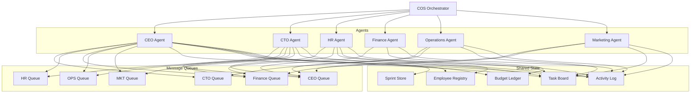

# Design Document: AI Company Operating System (COS)

## Overview

The AI Company Operating System (COS) is a multi-agent simulation platform that autonomously operates a startup company. Six AI agents — CEO, CTO, HR, Finance, Operations, and Marketing — run concurrently, communicate via message queues, manage shared state, and self-correct without human intervention.

The system is designed around three core principles:

1. **Autonomy**: Agents take initiative, escalate blockers, and self-correct within a sprint cycle.
2. **Auditability**: All state mutations are append-only and timestamped; nothing is deleted.
3. **Consistency**: Exclusive write locks and approval chains prevent race conditions and unauthorized state changes.

The platform operates on sprint-based fiscal cycles. Each sprint scopes work and budget. At sprint end, incomplete tasks roll over and a new sprint initializes automatically.

---

## Architecture

The system follows a shared-state, message-passing architecture. Agents are independent workers that read from their own input queues and write to shared state stores under exclusive locks.



### Key Architectural Decisions

**Message queues are FIFO per recipient.** Each agent has its own queue. The orchestrator routes messages by target agent role. This prevents head-of-line blocking across agents while preserving ordering guarantees per recipient.

**Shared state uses exclusive write locks.** Before any agent writes to `Budget_Ledger`, `Employee_Registry`, or `Activity_Log`, it must acquire a lock. This prevents concurrent corruption. Reads are lock-free.

**Approval chain is synchronous within a sprint cycle.** When a hire or high-value expense is initiated, the requesting agent enqueues an approval request to the CEO queue and suspends the associated task in PENDING state. The CEO processes the approval in the same sprint cycle.

**The orchestrator is stateless.** It routes messages, manages the sprint clock, and starts/stops agents. All durable state lives in the shared stores.

---

## Components and Interfaces

### COS Orchestrator

Responsible for:
- Instantiating all six agents at startup
- Managing the sprint lifecycle (start, tick, end, rollover)
- Routing inter-agent messages from outbound buffers to recipient queues
- Generating reports on demand
- Enforcing the startup sequence and halting on agent init failure

```
interface COSOrchestrator {
  start(): void
  stop(): void
  generateReport(): Report
  getCurrentSprint(): Sprint
  getTaskBoard(): Task[]
  getBudgetLedger(): LedgerEntry[]
  getEmployeeRegistry(): Employee[]
  getActivityLog(): ActivityEntry[]
}
```

### Agent Base

All agents share a common interface. Each agent runs a processing loop: dequeue message → decide action → acquire lock → mutate state → release lock → enqueue outbound messages.

```
interface Agent {
  role: AgentRole
  initialize(): void
  processMessage(msg: AgentMessage): AgentMessage[]
  tick(): AgentMessage[]          // proactive behavior each sprint tick
  getOutboundQueue(): AgentMessage[]
}
```

### Message Queue

Per-agent FIFO queue. The orchestrator writes to it; the agent reads from it.

```
interface MessageQueue {
  enqueue(msg: AgentMessage): void
  dequeue(): AgentMessage | null
  peek(): AgentMessage | null
  size(): number
  isEmpty(): boolean
}
```

### Shared State Stores

Each store exposes read and write operations. Writes require a lock token.

```
interface TaskBoard {
  createTask(task: Task): Task
  updateTask(id: string, patch: Partial<Task>): Task
  getTask(id: string): Task | null
  getAllTasks(): Task[]
  getTasksByStatus(status: TaskStatus): Task[]
}

interface BudgetLedger {
  append(entry: LedgerEntry): LedgerEntry
  getBalance(): number
  getAll(): LedgerEntry[]
  getEntriesSince(timestamp: string): LedgerEntry[]
}

interface EmployeeRegistry {
  addEmployee(employee: Employee): Employee
  updateEmployee(id: string, patch: Partial<Employee>): Employee
  getEmployee(id: string): Employee | null
  getAllEmployees(): Employee[]
}

interface ActivityLog {
  append(entry: ActivityEntry): ActivityEntry
  getAll(): ActivityEntry[]
  getEntriesSince(timestamp: string): ActivityEntry[]
}
```

### Write Lock Manager

Manages exclusive write locks on shared resources. Agents must acquire a lock before writing and release it after.

```
interface WriteLockManager {
  acquire(resource: SharedResource, agentRole: AgentRole): LockToken
  release(token: LockToken): void
  isLocked(resource: SharedResource): boolean
}

type SharedResource = 'budget_ledger' | 'employee_registry' | 'activity_log' | 'task_board'
```

### Report Generator

Assembles a point-in-time snapshot from all shared stores.

```
interface ReportGenerator {
  generate(sprint: Sprint): Report
  serialize(report: Report): string   // JSON
  deserialize(json: string): Report
}
```

---

## Data Models

### AgentRole

```typescript
type AgentRole = 'CEO' | 'CTO' | 'HR' | 'Finance' | 'Operations' | 'Marketing'
```

### AgentMessage

```typescript
interface AgentMessage {
  id: string
  from: AgentRole
  to: AgentRole
  type: MessageType
  payload: Record<string, unknown>
  timestamp: string        // ISO 8601
  correlationId?: string   // links approval responses to requests
}

type MessageType =
  | 'TASK_ASSIGNMENT'
  | 'APPROVAL_REQUEST'
  | 'APPROVAL_RESPONSE'
  | 'BLOCKER_ESCALATION'
  | 'BLOCKER_RESOLUTION'
  | 'BUDGET_ALERT'
  | 'STATUS_UPDATE'
  | 'HIRE_REQUEST'
  | 'EXPENSE_REQUEST'
```

### Task

```typescript
interface Task {
  id: string
  title: string
  owner: AgentRole
  status: TaskStatus
  priority: TaskPriority
  created_at: string       // ISO 8601
  updated_at: string       // ISO 8601
  sprint_id: string
  blocker_reason?: string
}

type TaskStatus = 'PENDING' | 'IN_PROGRESS' | 'BLOCKED' | 'COMPLETED'
type TaskPriority = 'LOW' | 'MEDIUM' | 'HIGH' | 'CRITICAL'
```

**Valid task state transitions:**

```
PENDING → IN_PROGRESS
IN_PROGRESS → BLOCKED
IN_PROGRESS → COMPLETED
BLOCKED → IN_PROGRESS
```

Any other transition is rejected and logged.

### LedgerEntry

```typescript
interface LedgerEntry {
  id: string
  description: string
  amount: number           // always positive
  type: 'CREDIT' | 'DEBIT'
  agent_role: AgentRole
  timestamp: string        // ISO 8601
  running_balance: number
  sprint_id: string
}
```

### Employee

```typescript
interface Employee {
  id: string
  name: string
  role: string
  department: string
  start_date: string       // ISO 8601
  onboarding_status: 'IN_PROGRESS' | 'COMPLETED'
  onboarding_checklist: OnboardingItem[]
}

interface OnboardingItem {
  step: 'equipment_setup' | 'system_access' | 'orientation' | 'role_briefing' | string
  completed: boolean
  completed_at?: string    // ISO 8601
}
```

### ActivityEntry

```typescript
interface ActivityEntry {
  id: string
  timestamp: string        // ISO 8601
  agent_role: AgentRole
  event_type: ActivityEventType
  description: string
  metadata?: Record<string, unknown>
}

type ActivityEventType =
  | 'TASK_CREATED'
  | 'TASK_STATE_CHANGED'
  | 'APPROVAL_REQUESTED'
  | 'APPROVAL_GRANTED'
  | 'APPROVAL_REJECTED'
  | 'EXPENSE_COMMITTED'
  | 'EXPENSE_REJECTED'
  | 'EMPLOYEE_ADDED'
  | 'ONBOARDING_COMPLETED'
  | 'BLOCKER_RAISED'
  | 'BLOCKER_RESOLVED'
  | 'BUDGET_ALERT'
  | 'SPRINT_STARTED'
  | 'SPRINT_COMPLETED'
  | 'AGENT_INIT_FAILED'
  | 'LOCK_ACQUIRED'
  | 'LOCK_RELEASED'
  | 'INCONSISTENCY_DETECTED'
  | 'SELF_CORRECTION_ATTEMPTED'
```

### Sprint

```typescript
interface Sprint {
  id: string
  start_date: string       // ISO 8601
  end_date: string         // ISO 8601
  budget_allocation: number
  status: 'ACTIVE' | 'COMPLETED'
}
```

### Report

```typescript
interface Report {
  generated_at: string     // ISO 8601
  sprint_id: string
  task_board: Task[]
  pending_approvals: PendingApproval[]
  employee_registry: Employee[]
  budget_ledger: LedgerEntry[]
  department_updates: DepartmentUpdate[]
  activity_log: ActivityEntry[]
  alerts: Alert[]
}

interface PendingApproval {
  task_id: string
  request_type: 'HIRE' | 'EXPENSE'
  requested_by: AgentRole
  requested_at: string
  payload: Record<string, unknown>
}

interface DepartmentUpdate {
  agent_role: AgentRole
  summary: string
  tasks_completed: number
  tasks_in_progress: number
  tasks_blocked: number
}

interface Alert {
  id: string
  type: 'LOW_BUDGET' | 'BUDGET_WARNING' | 'TASK_BLOCKED' | 'APPROVAL_PENDING'
  message: string
  timestamp: string
  severity: 'INFO' | 'WARNING' | 'CRITICAL'
}
```

---


## Correctness Properties

*A property is a characteristic or behavior that should hold true across all valid executions of a system — essentially, a formal statement about what the system should do. Properties serve as the bridge between human-readable specifications and machine-verifiable correctness guarantees.*

### Property 1: Agent initialization failure is logged and halts startup

*For any* agent role, if that agent's initialization throws an error, the COS SHALL append an entry to the Activity_Log containing the failure reason and SHALL not complete startup successfully.

**Validates: Requirements 1.4**

---

### Property 2: Message routing delivers to correct queue only

*For any* message from any sender agent to any target agent, after the COS routes the message, it SHALL appear in the target agent's queue and SHALL NOT appear in any other agent's queue.

**Validates: Requirements 2.1**

---

### Property 3: Message queue preserves FIFO ordering

*For any* sequence of messages enqueued to a recipient agent's queue, dequeuing all messages SHALL return them in the exact order they were enqueued.

**Validates: Requirements 2.2**

---

### Property 4: Undeliverable messages block originating task and are logged

*For any* message targeting an unavailable agent, the COS SHALL append a delivery failure entry to the Activity_Log and SHALL set the originating task's status to BLOCKED.

**Validates: Requirements 2.4**

---

### Property 5: Approval chain enforced before hire or high-value expense is committed

*For any* hire request or expense amount greater than $500, the action SHALL NOT appear in the Employee_Registry or Budget_Ledger until a corresponding CEO approval entry exists in the Activity_Log. Conversely, when CEO approval is granted, the action SHALL be executed and the task SHALL transition out of PENDING state.

**Validates: Requirements 3.1, 3.2, 3.4, 3.6**

---

### Property 6: Pending approval holds task in PENDING and surfaces in report

*For any* approval request that has not yet been resolved, the associated task's status SHALL be PENDING and the Report's `pending_approvals` section SHALL contain an entry for that request.

**Validates: Requirements 3.3**

---

### Property 7: CEO rejection blocks task with reason and is logged

*For any* approval request that the CEO_Agent rejects, the associated task's status SHALL be BLOCKED with a non-empty `blocker_reason`, and the Activity_Log SHALL contain a rejection entry.

**Validates: Requirements 3.5**

---

### Property 8: Created tasks have all required fields

*For any* task creation input, the resulting Task object SHALL have all required fields present and non-null: `id`, `title`, `owner`, `status`, `priority`, `created_at`, `updated_at`.

**Validates: Requirements 4.1**

---

### Property 9: Task state machine enforces valid transitions and rejects invalid ones

*For any* task in any state, a valid transition (PENDING→IN_PROGRESS, IN_PROGRESS→BLOCKED, IN_PROGRESS→COMPLETED, BLOCKED→IN_PROGRESS) SHALL succeed and update `updated_at`. An invalid transition SHALL be rejected and the Activity_Log SHALL contain a violation entry with the attempted transition.

**Validates: Requirements 4.2, 4.3**

---

### Property 10: Task completion sets status and timestamp

*For any* task completion event, the task's status SHALL be COMPLETED and `updated_at` SHALL be a valid ISO 8601 timestamp that is greater than or equal to `created_at`.

**Validates: Requirements 4.4**

---

### Property 11: Blocker identification sets task BLOCKED and routes escalation

*For any* blocker identified on a task, the task's status SHALL be BLOCKED and an escalation message SHALL appear in the appropriate target agent's queue.

**Validates: Requirements 4.5, 10.2**

---

### Property 12: Task board query returns all tasks with current status

*For any* sequence of task creations and status updates, querying the task board SHALL return all created tasks, each with its most recently set status.

**Validates: Requirements 4.6**

---

### Property 13: Committed ledger entries have all required fields

*For any* committed transaction, the resulting LedgerEntry SHALL have all required fields present and non-null: `id`, `description`, `amount`, `type`, `agent_role`, `timestamp`, `running_balance`.

**Validates: Requirements 5.1**

---

### Property 14: Budget ledger is append-only (immutability invariant)

*For any* sequence of ledger appends, entries at earlier indices SHALL remain byte-for-byte identical after subsequent appends. No entry SHALL be modified or removed.

**Validates: Requirements 5.2**

---

### Property 15: Running balance is always mathematically correct

*For any* sequence of CREDIT and DEBIT transactions committed to the ledger, the `running_balance` on each entry SHALL equal the sum of all prior entries' net amounts (CREDITs positive, DEBITs negative) plus the current entry's net amount.

**Validates: Requirements 5.3**

---

### Property 16: Low-balance threshold crossing emits alert

*For any* transaction that causes the `running_balance` to fall below the configured alert threshold, the Activity_Log SHALL contain a `BUDGET_ALERT` entry and the Report's `alerts` section SHALL include a corresponding alert.

**Validates: Requirements 5.4**

---

### Property 17: Overdraft prevention rejects and logs

*For any* proposed expense where `amount > current running_balance`, the transaction SHALL be rejected (not appended to the ledger) and the Activity_Log SHALL contain a rejection entry.

**Validates: Requirements 5.5**

---

### Property 18: Ledger query returns all entries in chronological order

*For any* sequence of committed transactions, querying the Budget_Ledger SHALL return all entries sorted by `timestamp` in ascending order.

**Validates: Requirements 5.6**

---

### Property 19: New employees have all required fields and correct initial onboarding state

*For any* approved hire, the resulting Employee object SHALL have all required fields present (`id`, `name`, `role`, `department`, `start_date`, `onboarding_status`, `onboarding_checklist`), `onboarding_status` SHALL be `IN_PROGRESS`, and the `onboarding_checklist` SHALL contain all four required steps: `equipment_setup`, `system_access`, `orientation`, `role_briefing`.

**Validates: Requirements 6.1, 6.2, 6.3**

---

### Property 20: Completing all onboarding items sets status to COMPLETED

*For any* employee, marking all items in their `onboarding_checklist` as complete SHALL cause `onboarding_status` to be set to `COMPLETED`.

**Validates: Requirements 6.4**

---

### Property 21: Activity log entries have all required fields

*For any* system event, the resulting ActivityEntry SHALL have all required fields present and non-null: `id`, `timestamp`, `agent_role`, `event_type`, `description`.

**Validates: Requirements 7.1**

---

### Property 22: Activity log is append-only (immutability invariant)

*For any* sequence of log appends, entries at earlier indices SHALL remain identical after subsequent appends. No entry SHALL be modified or removed.

**Validates: Requirements 7.2**

---

### Property 23: Every agent action produces a log entry

*For any* agent action (task creation, state transition, expense, hire, escalation, etc.), the Activity_Log SHALL contain a corresponding entry with the correct `agent_role` and `event_type` appended within the same processing cycle.

**Validates: Requirements 7.3**

---

### Property 24: Task state transitions are fully audited in the log

*For any* task state transition, the Activity_Log SHALL contain an entry recording the previous state, the new state, and the `agent_role` that triggered the transition.

**Validates: Requirements 7.4**

---

### Property 25: Activity log query returns all entries in chronological order

*For any* sequence of log appends, querying the Activity_Log SHALL return all entries sorted by `timestamp` in ascending order.

**Validates: Requirements 7.5**

---

### Property 26: Generated report contains all required sections with current data

*For any* system state, the generated Report SHALL contain all seven required sections (`task_board`, `pending_approvals`, `employee_registry`, `budget_ledger`, `department_updates`, `activity_log`, `alerts`), each populated with the current contents of the corresponding store, plus a valid `generated_at` ISO 8601 timestamp and a `sprint_id` matching the active sprint.

**Validates: Requirements 8.1, 8.2, 8.4**

---

### Property 27: Report serialization round-trip preserves equivalence

*For any* valid Report object, serializing it to JSON and then deserializing it SHALL produce a Report object that is structurally equivalent to the original (all fields equal, all nested arrays equal in order and content).

**Validates: Requirements 8.3, 8.5**

---

### Property 28: Sprint objects have all required fields

*For any* sprint creation, the resulting Sprint object SHALL have all required fields present: `id`, `start_date`, `end_date`, `budget_allocation`, `status`.

**Validates: Requirements 9.1**

---

### Property 29: Sprint end rolls over incomplete tasks and initializes new sprint

*For any* sprint with a mix of complete and incomplete tasks, after the sprint ends: the old sprint's status SHALL be `COMPLETED`, all tasks that were not `COMPLETED` SHALL have their `sprint_id` updated to the new sprint's id, and a new sprint with status `ACTIVE` and a fresh `budget_allocation` SHALL exist.

**Validates: Requirements 9.2**

---

### Property 30: Sprint expenditure tracking matches ledger DEBITs

*For any* sequence of expenses committed during an active sprint, the tracked sprint expenditure SHALL equal the sum of all DEBIT entries in the Budget_Ledger for that sprint.

**Validates: Requirements 9.3**

---

### Property 31: 80% budget utilization triggers warning alert

*For any* sprint `budget_allocation` and sequence of expenses where cumulative DEBITs reach or exceed 80% of `budget_allocation`, the Activity_Log SHALL contain a `BUDGET_WARNING` alert entry.

**Validates: Requirements 9.4**

---

### Property 32: Task creation without active sprint is rejected and logged

*For any* task creation attempt when no sprint with status `ACTIVE` exists, the task SHALL NOT be created and the Activity_Log SHALL contain an error entry.

**Validates: Requirements 9.5**

---

### Property 33: Inconsistency detection triggers log and self-correction attempt

*For any* injected inconsistency in shared state (e.g., negative balance, missing approval record), the detecting agent SHALL append an `INCONSISTENCY_DETECTED` entry to the Activity_Log and SHALL append a `SELF_CORRECTION_ATTEMPTED` entry indicating the workflow being re-run.

**Validates: Requirements 10.4**

---

### Property 34: Shared state mutations are always preceded by lock acquisition

*For any* mutation to a shared state store (`Budget_Ledger`, `Employee_Registry`, `Activity_Log`, `Task_Board`), the Activity_Log SHALL contain a `LOCK_ACQUIRED` entry for that resource by the mutating agent before the mutation entry, and a `LOCK_RELEASED` entry after.

**Validates: Requirements 10.5**

---

## Error Handling

### Agent Initialization Failure

If any agent fails to initialize, the COS logs the failure with the agent role and error message to the Activity_Log, then halts startup and surfaces a descriptive error to the caller. No partial state is left behind — the system does not start in a degraded mode.

### Message Delivery Failure

If a message cannot be routed to its target agent (e.g., agent not found, queue unavailable), the orchestrator logs a delivery failure to the Activity_Log and marks the originating task as BLOCKED with a `blocker_reason` describing the delivery failure.

### Invalid Task Transitions

The task board rejects any state transition not permitted by the state machine. The rejection is logged to the Activity_Log with the attempted transition, current state, and the agent that attempted it. The task remains in its current state.

### Approval Rejection

When the CEO rejects a hire or expense request, the system logs the rejection with the reason, sets the associated task to BLOCKED with the rejection reason in `blocker_reason`, and does NOT execute the action. The requesting agent may re-evaluate and re-submit.

### Overdraft Prevention

If a proposed expense would make the running balance negative, the Finance_Agent rejects the transaction before it is appended to the ledger. The rejection is logged. The task associated with the expense is set to BLOCKED.

### No Active Sprint

If a task creation is attempted when no ACTIVE sprint exists, the creation is rejected and logged. Agents should check for an active sprint before creating tasks; if none exists, they escalate to the CEO to initialize a new sprint.

### Lock Contention

If an agent attempts to acquire a write lock on a resource that is already locked, it waits (with a configurable timeout). If the timeout expires, the operation is aborted, logged as a lock timeout, and the associated task is set to BLOCKED. This prevents deadlocks from stalling the system indefinitely.

### Inconsistency Detection

When an agent detects an inconsistency (negative balance, missing approval, orphaned task), it logs the inconsistency with full context, then attempts self-correction by re-running the relevant workflow. If self-correction fails, it escalates to the CEO_Agent.

---

## Testing Strategy

### Dual Testing Approach

The COS has rich business logic (state machines, approval chains, ledger arithmetic, FIFO queues) that is well-suited to property-based testing. The testing strategy uses both unit/example tests and property-based tests.

**Unit / Example Tests** cover:
- Specific agent behavior scenarios (e.g., CEO approves a hire, Finance rejects an overdraft)
- Integration points between the orchestrator and agents
- Sprint lifecycle transitions (start, tick, end, rollover)
- Report generation with a known system state
- Error paths (init failure, lock timeout, no active sprint)

**Property-Based Tests** cover all 34 correctness properties defined above. Each property test generates random inputs across the relevant input space to find edge cases that example tests would miss.

### Property-Based Testing Library

Use **fast-check** (TypeScript/JavaScript) or **hypothesis** (Python), depending on the implementation language. Each property test runs a minimum of **100 iterations**.

Each property test is tagged with a comment in the following format:

```
// Feature: ai-company-os, Property N: <property_text>
```

### Test Organization

```
tests/
  unit/
    agents/
      ceo.test.ts
      cto.test.ts
      hr.test.ts
      finance.test.ts
      operations.test.ts
      marketing.test.ts
    stores/
      task-board.test.ts
      budget-ledger.test.ts
      employee-registry.test.ts
      activity-log.test.ts
    orchestrator.test.ts
    report-generator.test.ts
    sprint.test.ts
  property/
    message-queue.property.test.ts      // Properties 2, 3, 4
    approval-chain.property.test.ts     // Properties 5, 6, 7
    task-lifecycle.property.test.ts     // Properties 8, 9, 10, 11, 12
    budget-ledger.property.test.ts      // Properties 13–18
    employee-registry.property.test.ts  // Properties 19, 20
    activity-log.property.test.ts       // Properties 21–25
    report.property.test.ts             // Properties 26, 27
    sprint.property.test.ts             // Properties 28–32
    agent-behavior.property.test.ts     // Properties 1, 33, 34
  integration/
    sprint-cycle.integration.test.ts    // Requirements 2.3, 10.1, 10.3
    full-simulation.integration.test.ts // End-to-end sprint simulation
```

### Property Test Configuration

```typescript
// Example: Property 3 — FIFO ordering
// Feature: ai-company-os, Property 3: Message queue preserves FIFO ordering
fc.assert(
  fc.property(
    fc.array(fc.record({ id: fc.uuid(), payload: fc.string() }), { minLength: 1 }),
    (messages) => {
      const queue = new MessageQueue()
      messages.forEach(m => queue.enqueue(m))
      const dequeued = messages.map(() => queue.dequeue())
      return JSON.stringify(dequeued) === JSON.stringify(messages)
    }
  ),
  { numRuns: 100 }
)
```

### Integration Tests

Integration tests run a full sprint simulation with all six agents active. They verify:
- Agents self-assign unassigned tasks within a sprint cycle (Requirement 10.1)
- Escalated blockers are resolved or further escalated within a sprint cycle (Requirement 10.3)
- Messages are processed within the same sprint cycle (Requirement 2.3)

These tests use 1–3 representative scenarios rather than randomized inputs, since they test agent coordination behavior rather than pure function logic.
